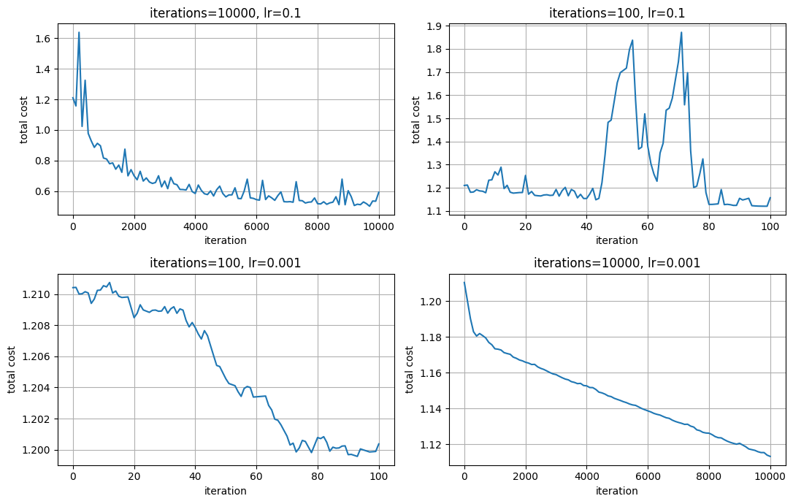
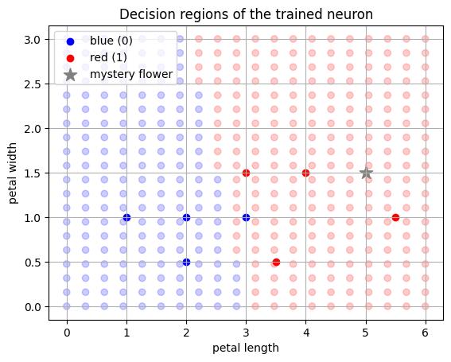
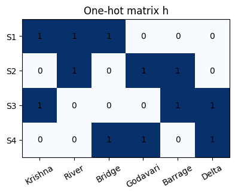

# Flower Classification with a Single Neuron & One-Hot Sentence Vectors

**Roll No:** G25AIT2032  
**Notebook:** [`flowers_G25AIT2032.ipynb`](flowers_G25AIT2032.ipynb)

A from-scratch (NumPy only) implementation of a single sigmoid neuron trained with stochastic gradient descent, followed by a short introduction to one-hot sentence encoding and a linear layer.

## Contents

| Part | Topic | What it shows |
|------|-------|---------------|
| 1 | Single-neuron classifier | Classify flowers as blue (0) / red (1) from petal length and width |
| 1 | Iterations & learning-rate experiment | Effect of 4 settings of `(iterations, lr)` on the cost curve |
| 1 | Mystery-flower prediction | Predict the class of a new point and plot decision regions |
| 2 | One-hot sentence vectors | Build vocabulary, sentence vectors and the matrix `h` |
| 2 | Linear layer | `S = h · W` with random `W` |

## Model

```
      o   flower type
     / \   w1, w2, b
    o   o  length, width
```

- Prediction: `pred = sigmoid(w1·length + w2·width + b)`
- Cost: squared error `(pred − target)²`
- Update: SGD on one random data point per iteration, gradients via the chain rule

## Results

### Iterations vs learning rate


| iterations | learning rate | outcome |
|-----------:|--------------:|---------|
| 10000 | 0.1   | Converges quickly (best) – noisy because of single-point SGD |
| 100   | 0.1   | Too few steps to converge |
| 100   | 0.001 | Almost no learning |
| 10000 | 0.001 | Smooth but still slow |

### Decision regions (10 000 iterations, lr = 0.1)


The mystery flower `[5, 1.5]` is predicted **red (1)** with probability ≈ 0.999.

### Part 2 – One-hot matrix
Sentences used:

| | Sentence |
|--|----------|
| S1 | Krishna River Bridge |
| S2 | Godavari River Barrage |
| S3 | Krishna Delta Barrage |
| S4 | Godavari Delta Bridge |

Vocabulary: `Krishna, River, Bridge, Godavari, Barrage, Delta` (6 words)  
`h` is **4 × 6**, `W` is **6 × 2**, output `S` is **4 × 2**.



## Changes / fixes made

1. **Missing waveforms fixed.** Cost was logged only when `i % 100 == 0`, so runs with 100 iterations produced a single point and an empty plot. The log interval now scales with the run length (`max(1, iterations // 100)`), and the four curves are drawn in a 2×2 grid.
2. **Prediction bug fixed.** The mystery-flower prediction previously used the weights of the *last* experiment (`lr = 0.001`), which is under-trained. It now uses the well-trained baseline model.
3. **Single `train()` function** replaces the two near-identical copies; the random seed is fixed (`2032`) for reproducible results.
4. **Part 2 matrix redesigned** with new sentences/vocabulary, automatic vocabulary building, labelled DataFrames, a heat-map and a sentence-similarity table.
5. Added axis labels, legends and an experiment summary table.

## Run it

```bash
git clone <your-repo-url>
cd <your-repo>
pip install -r requirements.txt
jupyter notebook flowers_G25AIT2032.ipynb
```

## Repository structure

```
.
├── flowers_G25AIT2032.ipynb
├── requirements.txt
├── README.md
├── .gitignore
└── images/
    ├── iterations_vs_lr.png
    ├── decision_regions.png
    └── one_hot_matrix.png
```
